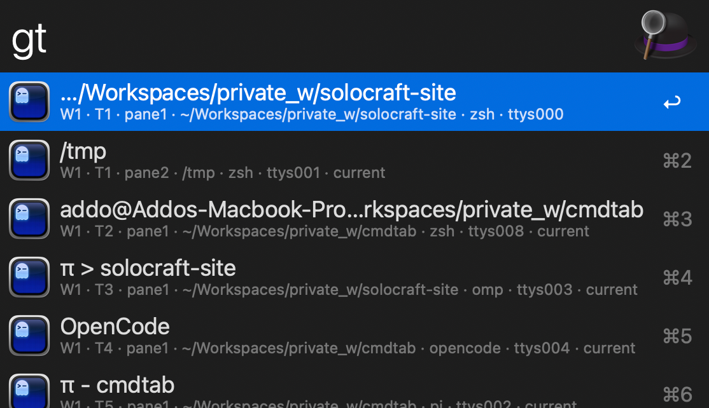

# alfred-ghostty

[English](README.md) | [简体中文](README.zh-CN.md)

> Alfred workflow: search & jump across ALL [Ghostty](https://ghostty.org) tabs and splits (panes), with directory opening and path copying.



Inspired by [alfred-browser-tabs](https://github.com/epilande/alfred-browser-tabs), built on **Ghostty 1.4+'s native AppleScript dictionary** — no Accessibility permission, no external dependencies.

## Features

### `gt` — search & jump

```
gt <keywords>
```

Lists **every window × tab × split** as one item per surface (a plain tab is just a single-surface item).

Match dimensions (concatenated into one `match` string; Alfred fuzzy-matches it, space-separated keywords AND together):

| Dimension | Source |
|---|---|
| Terminal title | Ghostty's current title (incl. shell-integration titles) |
| Tab title | title of the containing tab |
| Working directory | full cwd (updates live as you `cd`) |
| Running process | foreground pid resolved via `ps` (`vim`, `htop`…; idle shows `zsh`) |
| tty | e.g. `ttys001` |

| Key | Action |
|---|---|
| `↩` | Jump: bring window to front → select tab → focus the surface |
| `⌃↩` | Copy the surface's full working directory |
| `⌘C` on a result | Copy path (Alfred native) |

Item format: `W1 · T1 · pane2 · ~/path/to/cwd · zsh · ttys001`, the focused surface of each tab is marked `current`.

### `go` — open a folder

```
go            ← no argument
go ~/Workspaces/foo
```

| Input | Behavior |
|---|---|
| No argument | Opens **Finder's current folder** (falls back to home if no Finder window) |
| Type a path | Directory completion: `~` expanded, no-slash paths are relative to home; **Tab drills down**, `↩` opens |
| `↩` | Open in a new tab |
| `⌘↩` | Open in a new window |

Cold-starts Ghostty (new window at the folder) if it is not running.

## Install

1. Requirements: macOS, [Alfred 5](https://www.alfredapp.com) + Powerpack, **Ghostty ≥ 1.4**
2. Double-click `dist/alfred-ghostty.alfredworkflow` (or `make build`)
3. First-run consents (one prompt each):
   - "Alfred wants to control **Ghostty**" (needed by gt & go)
   - "Alfred wants to control **Finder**" (only for go's Finder fallback)

> No Accessibility permission needed — it talks to Ghostty's native scripting dictionary, not GUI events.

UI language follows your system's preferred language (Chinese or English).

## Development

```
make build    # pack dist/alfred-ghostty.alfredworkflow
make test     # 3-layer suite: plist contract / Script Filter JSON contract / live Ghostty integration
make clean
```

Scripts are runnable outside Alfred:

```
osascript -l JavaScript src/list-surfaces.js                        # enumerate
osascript -l JavaScript src/go.js "~/Work"                          # folder completion
action=focus window_id=... tab_id=... terminal_id=... \
  osascript -l JavaScript src/action.js                             # jump
```

```
info.plist            # object graph: gt(SF) → action.js ← go(SF) — 3 objects total
src/list-surfaces.js  # enumerate windows→tabs→terminals + batch ps lookup
src/go.js             # go completion: Finder fallback, ~ expansion, drill-down
src/action.js         # action dispatch: focus / copy / open / open_window
```

### Testing notes (`test/run-tests.sh`)

Alfred has no official test mechanism, so the suite simulates Alfred's invocation contract (cwd = workflow dir, item variables = env vars, query = argv) in three layers:

1. **info.plist contract** — connections reference existing objects, script files exist, no phantom env vars, no duplicate keywords
2. **Script Filter JSON contract** — gt/go output conforms to the Alfred spec (items shape, icon files exist, variables are strings), go's fallback
3. **Action integration** — against live Ghostty: open tab/window (assert cwd), split + focus round-trip, clipboard round-trip

Integration tests run inside a **throwaway tab in a temp directory** — they never touch your real surfaces; on exit the suite finds the shells holding those directories (`lsof +D`) and SIGKILLs them (interactive zsh ignores SIGTERM, and the scripting dictionary's `close` silently no-ops on some window types). Layer 3 auto-skips when Ghostty isn't running.

## Known limitations

- `gt` results don't refresh within a session — re-invoke to refresh
- Aliases are session-scoped (cleared when Ghostty quits)
- Alfred sorts filtered results by its own relevance; the `current` marker doesn't pin items to the top
- Split geometry (left/right/top/bottom) isn't exposed by the dictionary; panes are numbered by creation order

## Release

Versioned by git tag: bump `version` in `info.plist`, commit, then push a tag — CI (`.github/workflows/release.yml`) verifies tag ↔ plist version, runs the test suite, packs the workflow and publishes a GitHub Release with the `.alfredworkflow` attached:

```
git tag v1.0.0 && git push origin v1.3.0
```

## License

MIT. `icon.png` is derived from Ghostty's app icon and belongs to the Ghostty project.
